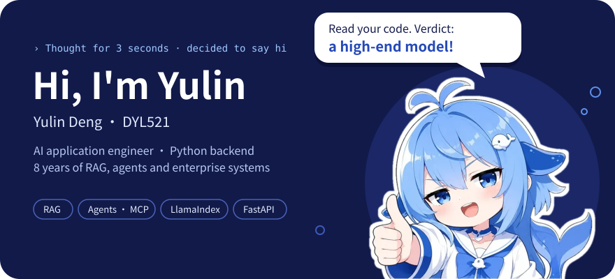

  

  
  
  

  <strong>Yulin Deng</strong> — AI application engineer, Python backend, 8 years in. 
  RAG, agents, enterprise integrations. Sharing what I build, learning from what you build.

## Selected work

> **[Jarvis Registry ↗](https://github.com/ascending-llc/jarvis-registry)** · Contributor 
> Enterprise MCP &amp; agent gateway. 
> Contributions: [embedding reindexing](https://github.com/ascending-llc/jarvis-registry/commit/cfa8267b5f57471544bce4a7e8b3ffe9ed05fb44) · [tool access controls](https://github.com/ascending-llc/jarvis-registry/commit/5ebe945115059765ab8d3da1b4422a62dbd15470) 
> Python · MCP · AI infrastructure

> **[Agentic Design Patterns CN ↗](https://github.com/DYL521/Agentic-Design-Patterns-CN)** · Learning resource 
> Agent design patterns with implementation examples, in Chinese and English. 
> AI agents · Design patterns · Chinese / English

## What I work on

| Focus | What I do |
| :--- | :--- |
| **RAG & knowledge** | End-to-end RAG: parsing, chunking, embedding, vector storage, retrieval, metadata filtering and cited answers. Query rewrite, intent detection, rerank and curated QA for messy enterprise docs. Multi-source sync (S3, Google Drive, SQL Server) with incremental, scheduled and manual modes. LlamaIndex · LangChain · Weaviate · OpenAI · AWS Bedrock |
| **Agents & MCP** | LangGraph agents with checkpointed state and session recovery. MCP servers for Google Workspace and SQL Server. PromptOps: prompts versioned outside the app repo and loaded by release tag. LangGraph · FastMCP · MySQL checkpointer · Docker Compose |
| **Backend & data** | Concurrent, network-heavy Python services and async task pipelines. MySQL indexing, transactions, locks, query tuning, sharding and disaster recovery. Redis cache penetration, breakdown and avalanche. FastAPI · Django / DRF · Flask · Celery · MySQL · Redis |
| **Identity & access** | Domain account lifecycle across internal systems: onboarding / offboarding, AD sync, MFA, permission-change alerts, vendor accounts. Spring Boot · Django · LDAP / AD · RocketMQ |
| **Workflow automation** | Jira Server / Data Center administration and extension, 100+ ScriptRunner Groovy scripts, custom REST endpoints, webhook → MQ integration across 10+ internal systems. Groovy · ScriptRunner · Jira REST API · Elasticsearch |
| **AI-assisted engineering** | Turning AI coding from chat into repeatable workflow: repo-level skills, AGENTS.md / CLAUDE.md, review checklists, safe boundaries. Claude Code · Codex · GitHub Copilot |

## Toolbox

| Area | Tools |
| :--- | :--- |
| Languages | `Python` `Java` `Go` `Groovy` `SQL` |
| LLM & AI | `LlamaIndex` `LangChain` `LangGraph` `FastMCP` `Weaviate` `OpenAI` `AWS Bedrock` `Prompt engineering` `Fine-tuning (LoRA)` |
| Backend | `FastAPI` `Django` `DRF` `Flask` `Celery` `Nameko` `Spring Boot` `MyBatis-Plus` |
| Data | `MySQL` `PostgreSQL` `Redis` `MongoDB` `Elasticsearch` |
| Messaging | `RabbitMQ` `RocketMQ` `Webhooks` |
| Cloud & infra | `Docker` `Docker Compose` `Kubernetes` `AWS` `Alibaba Cloud` `Git` |
| Integrations | `MCP` `LDAP / AD` `Jira` `Confluence` `ScriptRunner` `Feishu / Lark` `WeCom` `Google Workspace` `REST APIs` |

<strong>中文介绍 · 展开阅读</strong>

### 你好，我是玉林。欢迎交流，共同学习。

AI 应用工程师，Python 后端，8 年开发经验。关注 RAG、Agent 与企业系统集成。这里记录我参与的开源项目与整理的学习资料，欢迎交流技术思路，也期待从你的经历中学习。

**开源实践**

- **[Jarvis Registry](https://github.com/ascending-llc/jarvis-registry)**：企业 MCP 与 Agent 网关，参与 embedding 重建索引和工具访问控制等开发。
- **[Agentic Design Patterns CN](https://github.com/DYL521/Agentic-Design-Patterns-CN)**：整理 AI Agent 设计模式的中英文资料，结合概念与实现示例学习。

**工程方向**

- **RAG 与知识检索**：覆盖解析、分块、Embedding、向量存储、检索召回、元数据过滤、答案生成与可追溯引用的完整链路；针对“召回不准、答案无标准”的场景，结合 Query Rewrite、意图识别、Rerank 与标准 QA 库。支持 S3、Google Drive、SQL Server 等多源数据的增量、定时与手动同步。
   LlamaIndex · LangChain · Weaviate · OpenAI · AWS Bedrock
- **Agent 与 MCP**：基于 LangGraph 构建 Agent，提供状态保存与会话恢复；封装 Google Workspace、SQL Server 的 MCP Server；PromptOps 让提示词独立于应用仓库管理，按 release tag 加载。
   LangGraph · FastMCP · MySQL checkpointer · Docker Compose
- **后端与数据**：精通 Python，掌握并发编程与网络通信；深入理解 MySQL 索引、事务、锁机制，擅长 SQL 调优、分库分表与容灾；熟悉 Redis 线程模型，解决缓存穿透、击穿、雪崩问题。
   FastAPI · Django / DRF · Flask · Celery · MySQL · Redis
- **身份与权限**：域账号全生命周期管理，覆盖入离职、AD 同步、MFA、权限变更预警和外采系统账号，连接内部系统，减少重复操作。
   Spring Boot · Django · LDAP / AD · RocketMQ
- **协作流程自动化**：维护与扩展 Jira Server / Data Center，基于 ScriptRunner 开发 100+ Groovy 脚本，扩展 REST Endpoints，通过 Webhook → MQ 打通 10+ 内部系统。
   Groovy · ScriptRunner · Jira REST API · Elasticsearch
- **AI 辅助工程**：把 AI Coding 从“聊天式问答”变成可复用的工程流程，沉淀仓库级 Skill、AGENTS.md / CLAUDE.md、review checklist 与安全边界。
   Claude Code · Codex · GitHub Copilot

**工具箱**

| 领域 | 工具 |
| :--- | :--- |
| 语言 | `Python` `Java` `Go` `Groovy` `SQL` |
| 大模型与 AI | `LlamaIndex` `LangChain` `LangGraph` `FastMCP` `Weaviate` `OpenAI` `AWS Bedrock` `Prompt 工程` `模型微调（LoRA）` |
| 后端框架 | `FastAPI` `Django` `DRF` `Flask` `Celery` `Nameko` `Spring Boot` `MyBatis-Plus` |
| 数据 | `MySQL` `PostgreSQL` `Redis` `MongoDB` `Elasticsearch` |
| 消息 | `RabbitMQ` `RocketMQ` `Webhook` |
| 云与基础设施 | `Docker` `Docker Compose` `Kubernetes` `AWS` `阿里云` `Git` |
| 系统集成 | `MCP` `LDAP / AD` `Jira` `Confluence` `ScriptRunner` `飞书` `企业微信` `Google Workspace` `REST API` |

如果你也在探索这些方向，欢迎交流具体问题、讨论实现方案，一起学习进步。

[个人网站 ↗](https://dyl521.github.io/) · [代码仓库](https://github.com/DYL521?tab=repositories) · [邮件交流](mailto:1016068291@qq.com)

  <strong>Let’s exchange ideas.</strong> 
  RAG, backend engineering, or a problem you’re working through.  
  <a href="mailto:1016068291@qq.com">Email me</a> &nbsp; · &nbsp; <a href="https://dyl521.github.io/">Visit my website ↗</a>

DeepSeek-chan art: community fan art collected in <a href="https://github.com/the-beating-light-of-the-nail/deepseek-chan-meme-pack">deepseek-chan-meme-pack</a> (#050 and #123 by Zhihu artist @忻致知). A new pose every hour.

